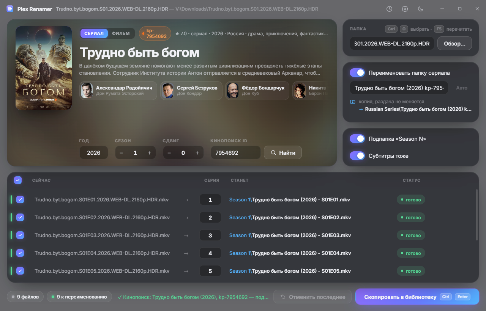
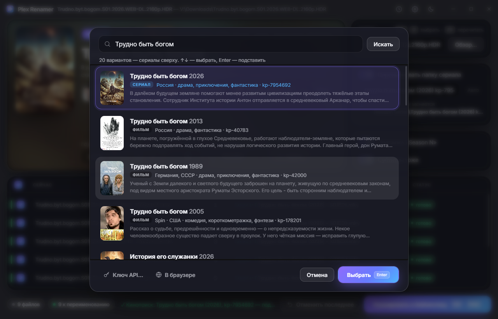

<div align="center">


# Plex Renamer

**Переименовывает серии так, как их понимает Plex, — одним нажатием**

[](https://github.com/MrJosu/plex-renamer-releases/releases/latest)
[](https://github.com/MrJosu/plex-renamer-releases/releases)


### [⬇ Скачать PlexRenamer-Setup.exe](https://github.com/MrJosu/plex-renamer-releases/releases/latest/download/PlexRenamer-Setup.exe)

</div>

<p align="center"></p>

---

Откройте папку со скачанным сезоном — программа сама узнает сериал, найдёт его на Кинопоиске и покажет,
как будут называться папка и серии. Остаётся нажать «Переименовать».

```
Poliarnyi.S06.2026.WEB-DL.1080p\               Полярный (2019) kp-1207237\
├── Poliarnyi.S06.E01.2026.WEB-DL.mkv    →    └── Season 6\
└── Poliarnyi.S06.E02.2026.WEB-DL.mkv             ├── Полярный (2019) - S06E01.mkv
                                                  └── Полярный (2019) - S06E02.mkv
```

## Что умеет

| | |
|---|---|
| 🔎 **Узнаёт сериал** | Название, год и сезон определяются по именам файлов и папки, в том числе по транслиту: `Tiazhelyi.liuks` → «Тяжёлый люкс». |
| 🎬 **Кинопоиск** | Сам находит сериал и подставляет его номер в имя папки: `Название (Год) kp-1234567`. Если одноимённых несколько — покажет список с постерами. |
| 🔢 **Номера серий** | Понимает `S03E05`, `3x05`, `Серия 5`, `05. Название`, двойные серии и абсолютную нумерацию (сдвиг номера). Номер можно поправить вручную. |
| 💬 **Субтитры** | Переименовываются вместе с видео, метка языка сохраняется: `.rus.srt`, `.eng.forced.ass`. |
| 🗂 **Перенос в библиотеку** | После переименования переносит сериал в папку библиотеки и просит Plex обновить именно её. |
| ↩️ **Безопасно** | При любой ошибке всё откатывается, «Отменить последнее» возвращает и файлы, и папку. Общие папки вроде `downloads` случайно не переименует. |
| 🔄 **Автообновление** | Новая версия ставится сама. Обновления подписаны: чужой файл программа не установит. |

<p align="center"></p>

Цвет статуса подсказывает, что будет с файлом: зелёный — готово, жёлтый — проверьте, красный — будет пропущен.

## Как начать

1. Скачайте и запустите [PlexRenamer-Setup.exe](https://github.com/MrJosu/plex-renamer-releases/releases/latest/download/PlexRenamer-Setup.exe).
   Ставится для текущего пользователя, права администратора не нужны.
2. Выберите папку с сериями или перетащите её в окно. Сетевые папки тоже подходят.
3. Проверьте название, год и сезон, посмотрите колонку «Станет».
4. Нажмите «Переименовать».

> [!NOTE]
> При первом запуске Windows может показать предупреждение SmartScreen: у установщика нет платной подписи издателя.
> Нажмите «Подробнее» → «Выполнить в любом случае».

> [!TIP]
> Для поиска на Кинопоиске нужен бесплатный ключ [kinopoiskapiunofficial.tech](https://kinopoiskapiunofficial.tech) — он вставляется в настройках.
> Без ключа программа тоже работает: номер сериала можно вписать вручную или вставить ссылкой с Кинопоиска.

## Вместе с Plex Follow

[Plex Follow](https://github.com/MrJosu/plex-follow-releases) делает то же самое без вашего участия: следит за раздачей,
докачивает новые серии и раскладывает их в библиотеку по тем же правилам.

## Про этот репозиторий

Здесь лежат только готовые установщики и файл `latest.json`, по которому программа узнаёт о новой версии.
Исходный код — в закрытом репозитории. Список изменений каждой версии — на странице
[релизов](https://github.com/MrJosu/plex-renamer-releases/releases).

Программа сделана для себя и выложена как есть, без гарантий.
